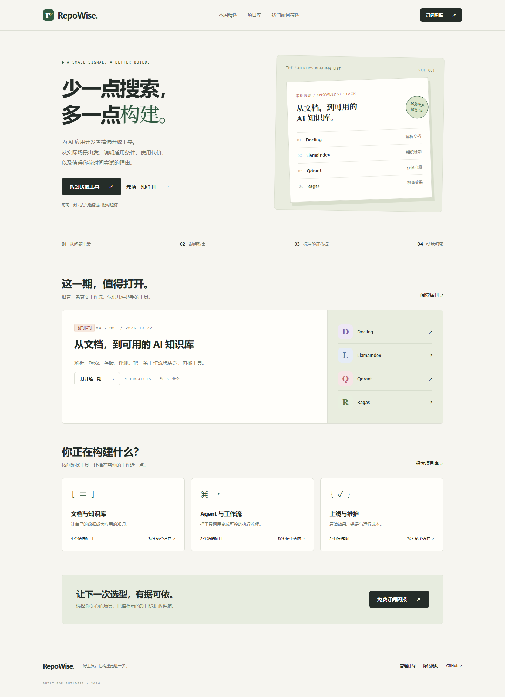

# RepoWise

**为 AI 应用开发者精选开源工具。按场景发现项目，说明适用条件、使用代价与验证依据。**

RepoWise 是一个可以本地运行、自托管的中文订阅产品 MVP。包含网站、真实订阅数据存储、邮箱二次确认、个性化周报匹配、编辑审核与投递记录。默认使用本地邮件预览，不会真实发信。



## 已实现

- 首页、创刊样刊、搜索与主题筛选、项目详情及来源记录。
- 六个经过官方资料核查的项目；创刊样刊沿着文档解析、检索、向量存储、评测展开。
- 邮箱确认后才激活订阅；主题、接入语言、部署偏好参与筛选，每期最多五项，无匹配时跳过。
- 免密码管理链接、偏好修改、关注列表、项目反馈、退订与数据删除。
- SQLite 持久化，开发邮件箱，Resend 真实投递适配器。
- 编辑后台、内容版本绑定的投递批准、重复投递防护、失败记录与受控重试。
- GitHub 候选收集脚本、默认关闭的周报定时工作流、Docker 部署文件。
- API 集成测试、邮件服务模拟测试、桌面和移动端浏览器测试。

**当前推荐均标记为“资料核查”，没有冒充安装验证或任务实测。不提供未经验证的性能排名。**

## 本地启动

需要 Node.js 24 或更新版本。生产运行不需要安装第三方 npm 依赖；测试依赖 Playwright。

```sh
git clone https://github.com/liruoshui-com/repowise.git
cd repowise
npm start
```

打开 [localhost:3000](http://localhost:3000)。首次启动会在 `var/` 创建数据库。Node 24 的 `node:sqlite` 可能显示实验性提示。

体验完整流程：

1. 在 `/subscribe` 输入测试邮箱并选择偏好。
2. 打开 `/dev/mail`，点击确认链接，再点击“确认订阅”。
3. 在项目详情保存关注和反馈；在 `/manage` 修改偏好或退订。
4. 若要体验编辑后台，把 `.env.example` 复制为 `.env`，填写随机的 `ADMIN_TOKEN`（至少 32 字符），重启后在 `/admin` 输入。
5. 先批准样刊，再生成本地周报，在 `/dev/mail` 查看匹配后的内容。

生成随机管理密钥：

```sh
node -e "console.log(require('node:crypto').randomBytes(32).toString('hex'))"
```

`.env`、`var/`、数据库、邮件和候选数据均被 Git 忽略。不要把实际邮箱或密钥写入内容文件。

## 测试

```sh
npm ci
npm test
npx playwright install chromium
npm run test:browser
```

接口测试使用临时数据库与模拟邮件服务。浏览器测试启动独立的 3107 端口，在 `var/browser-*` 保存测试数据；不会发送真实邮件。运行测试需要本机回环网络权限。截图和失败轨迹输出到 `test-results/`。

## 编辑与周报

项目与刊物保存在 `content/catalog.json`。编辑、复核官方来源后提交内容变更，服务重启后生效。把最新刊物放在 `issues` 第一项。`status: published` 表示可公开阅读，**实际投递仍需在后台批准**。批准记录绑定刊物和相关项目内容的哈希；修改后需要重新批准。

```sh
npm run collect
npm run digest -- 001
npm run digest -- 001 --send
```

`collect` 从 GitHub 获取公开候选元数据，保存到 `var/candidates/`，不会直接进入推荐池。可通过 `GITHUB_TOKEN` 提升 API 限额。默认的 `digest` 仅预演；加入 `--send` 才请求服务投递，要求 `BASE_URL`、`ADMIN_TOKEN` 和已批准刊物。

定时投递工作流默认关闭。部署完成后设置仓库变量 `SITE_URL`、`WEEKLY_ENABLED=true` 和 Secret `ADMIN_TOKEN`，每周五北京时间 09:00 请求投递最新的已批准刊物。未经批准时任务失败，不会自动批准。GitHub Actions 的计划执行可能延迟。

详见 [编辑手册](docs/editorial.md) 与 [部署说明](docs/deployment.md)。

## 技术结构

```text
public/                 原生 HTML、CSS、JavaScript 网站
content/catalog.json    编辑维护的项目与刊物
server/app.js           HTTP 路由、确认与管理、编辑操作
server/store.js         SQLite 表结构
server/content.js       内容校验、偏好校验、项目匹配
server/mail.js          持久投递记录与 Resend 适配器
scripts/collect.js      GitHub 候选采集
scripts/digest.js       已批准周报投递入口
test/                   接口测试与浏览器测试
```

## 首版边界

这是用于验证前 20～30 位试用者的 MVP：推荐由编辑审核，关注列表已实现，自动监测项目重要变化、收费、多编辑账户、邮件退信/投诉 Webhook 尚未实现。不能把“服务商接受邮件”当成“用户收到邮件”。正式开放规模化订阅前，应接入退信与投诉抑制，并完成真实域名投递验证。

SQLite 部署按单实例设计，需持久磁盘。当前发送在请求内串行执行，适合小规模试验；大量订阅者应迁移到独立任务队列。邮件记录含管理链接，需按敏感数据保护并设定保留周期。生产环境启动检查、API 测试并不等于完整安全审计。

代码使用 [MIT License](LICENSE)。第三方项目、名称与标识的权利归各自所有者；本项目与收录项目没有隶属关系。
